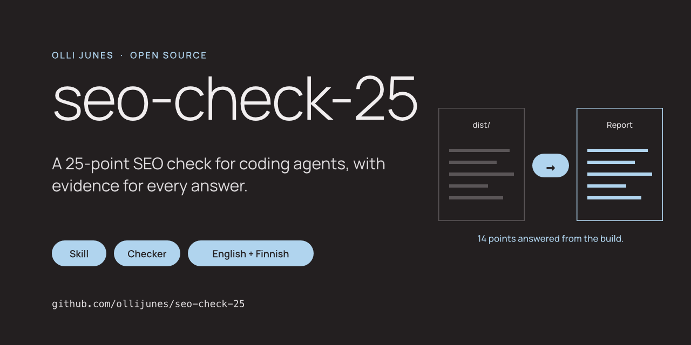

# seo-check-25



[](https://github.com/ollijunes/seo-check-25/actions/workflows/ci.yml)
[](pyproject.toml)
[](LICENSE)

A 25-point SEO check that a coding agent runs on your site, and `seo-check`,
a command that answers the points a machine can answer from the build
folder.

Ask an agent to "check the SEO" and you get a confident list with no
evidence: some of it right, some of it invented, none of it repeatable.
This repository gives the agent a fixed list instead. Every point has a way
to check it and a definition of passing. Every answer needs evidence, and
"not checked" is an allowed answer.

Two parts:

- **The skill**, in English
  ([`skills/seo-check-25`](skills/seo-check-25/SKILL.md)) and Finnish
  ([`skills/seo-tarkistus-25`](skills/seo-tarkistus-25/SKILL.md)). It covers
  indexing, structure, performance, content quality, spam policies and
  access for AI crawlers, and it tells the agent what it must not touch.
- **`seo-check`**, which reads a built site from disk, answers 14 of the 25
  points and flags three more for a person to read. It needs no network
  and changes nothing.

[Security](SECURITY.md) · [Contributing](CONTRIBUTING.md) ·
[ollijunes.com](https://ollijunes.com)

Read the story behind it: [in English](https://ollijunes.com/seo-check-25-a-25-point-seo-check-for-coding-agents/) · [suomeksi](https://ollijunes.com/fi/seo-check-25-25-kohdan-seo-tarkistus-koodausagentille/).

## Who it is for

People who build static or server-rendered sites with an agent's help and
want an SEO review they can repeat before each release. It is a technical
checklist, not a growth strategy.

## Use the skill

With Claude Code, copy the folder to your personal skills:

```sh
git clone https://github.com/ollijunes/seo-check-25
cp -R seo-check-25/skills/seo-check-25 ~/.claude/skills/seo-check-25
```

Then ask for an SEO check of a site or a build. With another agent, point
its instruction file at the skill:

```markdown
For an SEO review, read and follow skills/seo-check-25/SKILL.md.
```

The skill tells the agent to read only: no changes to production
robots.txt, redirects or deployments, at most two parallel requests, and
nothing submitted to Search Console or sent to third parties.

## Use the checker

You need Python 3.11 or newer. There are no other dependencies.

```sh
uv tool install git+https://github.com/ollijunes/seo-check-25
npm run build
seo-check dist --site https://example.com
```

```text
 1  OK           Content is in the HTML without JavaScript: every indexable page has text in the raw HTML; no file over 2 MB
 2  FIX          Sitemap: no sitemap*.xml in the build folder
 3  NOT CHECKED  Sitemap submitted to Search Console: needs the owner's Search Console; see the skill
 4  FIX          robots.txt lets Googlebot in: no Sitemap: line
 7  FIX          No broken internal links: 1 links to pages that do not exist
      blog/rye/index.html: /flour/
 8  FIX          One canonical link per page: 1 pages
      index.html: 0 canonical links
13  FIX          No orphan pages: 2 orphan pages
      /blog/rye/: no internal link points here
      /fi/blogi/ruis/: no internal link points here
22  OK           AI crawler access in robots.txt: no search crawler is blocked; a firewall or CDN can still block them: test the live site
      search    Googlebot: allowed (by the * group)
      search    OAI-SearchBot: allowed (by the * group)
...
3 pages. 7 to fix, 0 to review, 10 not checked here: those need the live site, the owner or a reader.
```

That is a shortened run on a three-page test site.

| Option | Meaning |
| --- | --- |
| `--site URL` | The site's address. Absolute links to it count as internal, and canonical links are checked against it. A path such as `https://example.com/docs/` means the folder is served under `/docs` |
| `--strict` | Exit with code 1 when any point is FIX. For CI |
| `--json` | Machine-readable report |
| `--all` | Every line of evidence, not the first five |

Statuses: `OK`, `FIX`, `REVIEW` (a person decides), `N/A`, `NOT CHECKED`.

## Evidence from a published page

The optional `seo-check-evidence` command reads a Firecrawl Local scrape, a SEOmator
audit, or both from disk. It checks that the reports cover the requested page.
The build checker still works offline with the same 25 points.

```sh
seo-check-evidence https://example.com/ --firecrawl page.json --seomator audit.json
```

To collect the two JSON files, follow the single-page workflow in
[English](skills/seo-check-25/SKILL.md#evidence-from-a-published-page) or
[Finnish](skills/seo-tarkistus-25/SKILL.md#julkaistun-sivun-tarkistus).

## The 25 points

| # | Point | `seo-check` |
| --- | --- | --- |
| 1 | Content is in the HTML without JavaScript; files under Googlebot's 2 MB | checks |
| 2 | Sitemap lists every indexable page and nothing else | checks |
| 3 | Sitemap submitted to Search Console | owner |
| 4 | robots.txt lets Googlebot in and names the sitemap | checks |
| 5 | noindex only where intended | checks |
| 6 | No redirect chains | live site |
| 7 | No broken internal links | checks |
| 8 | One absolute, self-referencing canonical per page | checks |
| 9 | A unique meta description on every page | checks |
| 10 | One h1 per page | checks |
| 11 | FAQ content is visible text | flags FAQPage markup |
| 12 | Breadcrumbs on deeper pages | checks BreadcrumbList |
| 13 | No orphan pages | checks |
| 14 | Alt text on images | checks |
| 15 | Modern image formats, width and height | checks |
| 16 | CLS and INP | field data |
| 17 | LCP and time to first byte | field data |
| 18 | No machine-sounding text | reader |
| 19 | A real author | flags Person markup |
| 20 | Quality backlinks | owner |
| 21 | Spam policies | flags history manipulation; the rest needs a reader |
| 22 | AI crawler access | checks robots.txt for ten crawlers |
| 23 | No accidental snippet limits | checks |
| 24 | Main content: effort, originality, skill, accuracy | reader |
| 25 | Bing index | owner |

The skill has the method and the passing condition for each.

## Limitations

- `seo-check` reads files. It does not fetch the live site, so headers,
  redirects, firewalls, speed and what a crawler really receives are
  outside it. A clean report covers fourteen points, not twenty-five.
- It reads the HTML the build wrote. A page rendered only on request (SSR)
  is not in the folder and is not checked.
- It does not judge quality. It counts an `alt` attribute, not whether the
  text is any good; a meta description, not whether anyone would click.
- robots.txt is read in a simple way: the crawler's own group, or `*`.
  Wildcards inside paths and the longest-match rule are not evaluated, and
  a partial block is reported as "partly blocked" for you to read.
- Search engines change their rules. The facts in the skill were checked
  against Google's and the crawler vendors' own pages on 19 November 2026. Check a claim against the search
  engine's own documentation before you put it in front of a customer.
- No SEO check can promise rankings. This one finds things that are broken.
- Not covered: hreflang, local SEO, migrations, consent and measurement,
  image and video search.

## Development

```sh
uv sync --locked
uv run python -m pytest --cov=seo_check --cov-fail-under=90
uv run ruff check .
uv run ruff format --check .
python3 scripts/check_public_tree.py
```

The tests build small sites in a temporary folder and never use the
network.

## License

[MIT](LICENSE). Made by [Olli Junes](https://ollijunes.com). Powered by [ResaHost](https://resahost.net/en/). Not affiliated
with Google, Microsoft, OpenAI, Anthropic or Perplexity.
